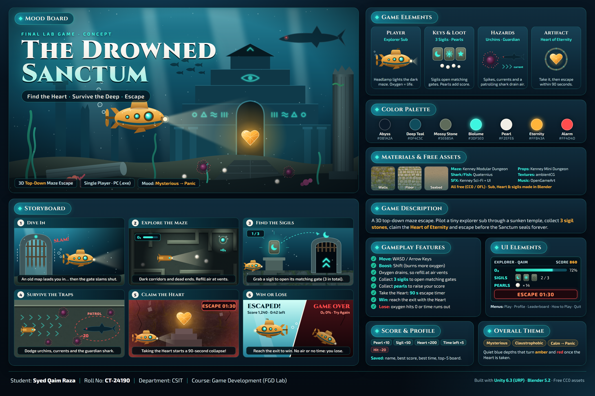

# The Drowned Sanctum

A 3D top-down maze-escape game made in **Unity 6.3 (URP)** with custom props modelled in **Blender 5.2**.

> An old map led you to a temple beneath the sea. The moment you swam inside, the gate sealed shut behind you.
> Find the three sigils, claim the **Heart of Eternity**, and escape before the Sanctum seals itself forever.



## Documentation (submission items)

| Item | File |
|---|---|
| Gameplay demo video (40 s trailer, voiceover + music) | [`Documentation/DrownedSanctum_Trailer.mp4`](Documentation/DrownedSanctum_Trailer.mp4) |
| Running demo / presentation of the project (14 slides) | [`Documentation/DrownedSanctum_Presentation.pdf`](Documentation/DrownedSanctum_Presentation.pdf) |
| Prompts: formal record of the AI-assisted development | [`Documentation/DrownedSanctum_Prompts.pdf`](Documentation/DrownedSanctum_Prompts.pdf) |
| Mood board and storyboard | [`MoodBoard/DrownedSanctum_MoodBoard_CT-24190.pdf`](MoodBoard/DrownedSanctum_MoodBoard_CT-24190.pdf) |
| Gameplay screenshots | [`Documentation/screenshots/`](Documentation/screenshots) |

The editable HTML sources of both PDFs are in `Documentation/source/`.

## Play

Run `Build/DrownedSanctum.exe` (Windows 64-bit). Type an explorer name, press **DIVE IN**.

| Key | Action |
|---|---|
| WASD / Arrow keys | Swim |
| Shift | Boost (uses more oxygen) |
| Space (or Q) | Sonar ping: an arrow points to your current objective (costs a little oxygen) |
| Esc / P | Pause (resume, how to play, restart, main menu) |
| Enter | Start a dive from the menu or the intro card |

### Objective and rules
1. Find the **Moon Sigil**: it opens the **Moon Gate** to the flooded west wing.
2. The **Sun Sigil** (west wing) opens the **Sun Gate** to the east halls.
3. The **Star Sigil** (east halls, guarded by a shark) opens the **Star Gate** to the Heart chamber.
4. Take the **Heart of Eternity**. A 90-second escape starts, the Star Gate slams shut and a cracked wall collapses to reveal a shortcut.
5. Reach the entrance gate with the Heart: **you win**.

**You lose** if your oxygen reaches 0 or the escape timer runs out.
Oxygen drains constantly, faster when boosting and during the escape. Hover over glowing **air vents** to refill.
**Urchins** and the **guardian shark** cost oxygen and points, and **currents** push you around.

### Scoring
| Event | Points |
|---|---|
| Pearl | +10 |
| Sigil | +50 |
| Heart of Eternity | +200 |
| Each second left on the escape timer | +5 |
| Each hit taken | -20 |

### Player profile and progress
- Your explorer name is your **profile**. Each profile stores best score, fastest escape, dives, escapes, pearls collected and last dive.
- A **top-10 leaderboard** keeps every run's score, time and result.
- **Options**: master and music volume, difficulty (Easy / Normal / Hard) and fullscreen. There's also a two-click "reset all data" button.
- Everything is saved as JSON in `PlayerPrefs` (see `Assets/Scripts/Core/SaveSystem.cs`).

## Changing things (evaluation cheat-sheet)

| To change... | Do this |
|---|---|
| **Any gameplay number** (speed, oxygen drain, vent refill, damage, shark speed, escape time, every score value, difficulty multipliers) | Menu **Drowned Sanctum > Edit Game Settings** (or select `Assets/Settings/GameSettings.asset`) and edit it in the Inspector. Changes apply as soon as you press Play. |
| **The maze layout** | Edit `Assets/Level/level_map.txt` (the legend is in the file), then **Drowned Sanctum > 1. Build Everything**. |
| **A single object** (move an urchin, add a pearl, re-time a gate) | Open `Assets/Scenes/Game.unity` and edit it directly, or drag prefabs from `Assets/Prefabs`. |
| **How a pickup, gate or hazard behaves** | `Assets/Scripts/World/` (`Pickup.cs`, `Gate.cs`, `Hazard.cs`, `CurrentZone.cs`, `SharkPatrol.cs`, `AirVent.cs`, `CrackedWall.cs`) |
| **Win / lose rules, scoring logic, oxygen** | `Assets/Scripts/Core/GameManager.cs` |
| **Movement / controls** | `Assets/Scripts/Player/PlayerController.cs` |
| **HUD and menus** | `Assets/Scripts/UI/GameHUD.cs` and `MainMenu.cs` |
| **Make a new exe** | **Drowned Sanctum > 2. Build Windows EXE** (output in `Build/`) |

> Note: **1. Build Everything** regenerates the scenes and prefabs from code. If you hand-edit `Game.unity`, don't run it afterwards, or your edits are replaced. `GameSettings.asset` is never overwritten.

## Project structure

```
Assets/
  Scripts/Core      GameManager, GameSettings, SaveSystem, SFX, FxUtil
  Scripts/Player    PlayerController, CameraFollow
  Scripts/World     Pickup, Gate, Hazard, CurrentZone, SharkPatrol, AirVent, CrackedWall, EscapeSequence, decor
  Scripts/UI        GameHUD, MainMenu, UISound
  Scripts/Dev       DevAutoTest (automated playtest, only runs with -autotest)
  Editor            SanctumBuilder*.cs: builds settings, materials, prefabs, scenes and the exe
  Level             level_map.txt
  Models/Custom     Blender-made props (sub, Heart, sigil tablet, pearl, urchin, vent, seaweed, coral, altar)
  ThirdParty        Kenney, Quaternius, ambientCG assets (CC0)
  Settings          GameSettings, URP asset, post-processing volumes
Blender/            build_sanctum_props.py (the modelling script) + SanctumProps.blend
MoodBoard/          mood board + storyboard (PNG/PDF/HTML)
Tools/              texture and menu-art generators
```

## Automatic rebuilds (`build.ps1`)

The repo root has a script that rebuilds `Build/DrownedSanctum.exe` when the project changes. Close the Unity Editor first (Unity locks an open project) and keep Unity Hub signed in.

| Run | What it does |
|---|---|
| `build.bat` (double-click) or `.\build.ps1` | Builds only if something under `Assets/`, `Packages/` or `ProjectSettings/` changed since the last successful build. Otherwise it says "nothing to do". |
| `build-watch.bat` or `.\build.ps1 -Watch` | Keeps running and rebuilds a few seconds after you save a change. Ctrl+C stops it. |
| `.\build.ps1 -Force` | Rebuilds even if nothing changed. |
| `.\build.ps1 -Regenerate` | Regenerates the scenes and prefabs from code first (same as **Drowned Sanctum > 1. Build Everything**). |

Changing `Assets/Level/level_map.txt` or anything in `Assets/Editor/` regenerates the scenes automatically. Any other change rebuilds the exe from the scenes as they are, so your hand edits are kept. Logs go to `Logs/autobuild-*.log`.

## Building from source
1. Open the folder in **Unity 6000.3.24f1** (Unity Hub > Add project from disk).
2. Optional: **Drowned Sanctum > 1. Build Everything** regenerates settings, prefabs and scenes.
3. **Drowned Sanctum > 2. Build Windows EXE**, or *File > Build Profiles > Build*.

Automated playtest (screenshots and log of a full run):
```
Build/DrownedSanctum.exe -autotest -autotestOut C:\temp\shots -screen-fullscreen 0 -screen-width 1600 -screen-height 900
```

## Credits
All third-party assets are free (CC0 / OFL). See [`_DownloadedAssets/CREDITS.md`](_DownloadedAssets/CREDITS.md).
- 3D props: **Kenney** (Mini Dungeon), fish and shark: **Quaternius** (Animated Fish Pack)
- Textures: **ambientCG** (Rock064, PavingStones138, Ground054)
- Sound: **Kenney** (Interface Sounds, Sci-Fi Sounds); music: **cynicmusic** "Aquaria", **isaiah658** "Underwater Ambient Pad"
- Fonts: **Cinzel**, **Exo 2** (Google Fonts, OFL)
- Explorer sub, Heart of Eternity, sigil tablet, pearl, urchin, air vent, seaweed, coral and altar: modelled in Blender for this project (`Blender/build_sanctum_props.py`).
